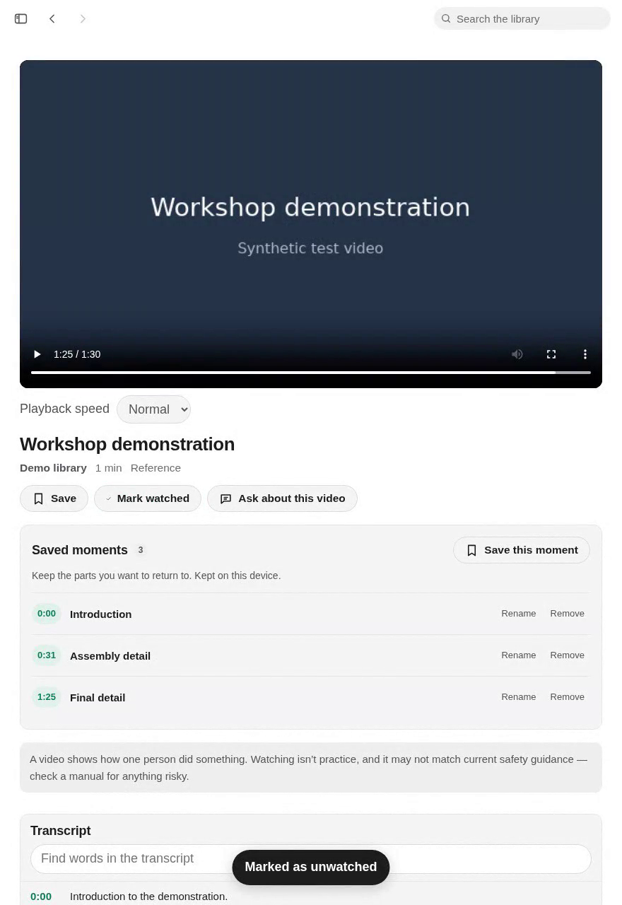
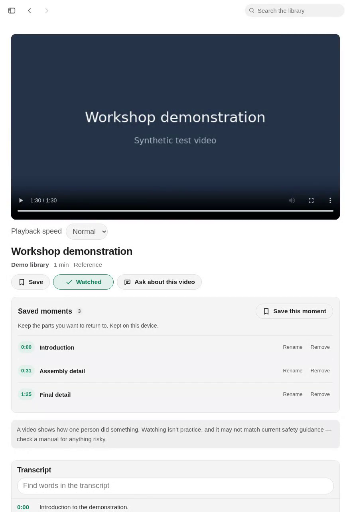

# Watched markers and saved moments

Compatibility review for [Lastbook PR #344](https://github.com/Immortal-Protocols/lastbook/pull/344), following the maintainer's request after saved moments shipped in 1.1.15.

## Revisions

- Reviewed watched-marker head: `ec84b0d6ea25a8ba232ed72078bcf788201d3645`.
- Current-main snapshot: `96456866f166d1baa9fed38e11f1df39ecbe94bf`.
- Combined source before the correction: `f734093f54be5af8c9bd2888c668571f65fc8c3f`.
- Tested correction: `e10d6df06e50148fd144a004227290ec471bb3f0`.
- Application tree: `fd8867bf158022380931e68fced74691cde7cbab`.

The integration preserves the original contributor commits. The correction itself touches `web/app.js` and two test files. [Standalone patch](watched-state-fix.patch).

## Findings and correction

Without an explicit watched choice, the proposed watched marker falls back to the latest resume position. Opening a saved moment at 1:25 in a 1:30 video while paused can therefore make it appear watched after reloading. Jumping within the player or using a paused scrub has the same effect. Conversely, rewinding a legacy completed video can remove its watched marker.

The correction preserves the previous completion state before progress is overwritten. This keeps existing completion and manual choices while allowing the existing playback handlers to mark a video watched.

## Validation

[Successful verification run](https://github.com/TheTradoor/lastbook/actions/runs/44972150723).

| Check | Before correction | After correction |
| --- | --- | --- |
| Focused watched/progress storage cases | 4 pass, 5 fail | 9 pass |
| Watched/moment browser scenarios | 9 pass, 4 fail | 13 pass |
| Existing saved-moment browser checks | Not rerun on the baseline in the final workflow | 52 pass |
| Focused Python tests | See individual regression results above | 33 pass |

The five storage failures also reproduce directly against the original PR head. The workflow restores the pre-correction JavaScript and requires the exact four browser failures to reproduce. Both browser runs use the same scenario definitions, real Chromium media events, the actual HTTP server, and a synthetic 90-second video. No JavaScript page errors or external application requests were recorded.

The passing scenarios cover near-end jumps from Saved and the player, fresh paused scrubs, explicit unwatched choices, paused seeks to the end, playback across 90%, rewatching, playback to the end, explicit 0:00 links, older progress, persistence beyond the 60-item resume history, read-only Saved storage, and layouts.

The full contributor command ran 569 tests on the correction and 568 on clean main in the same local environment. Both report 4 skips, 13 expected failures, and the same 2 failures plus 2 errors:

- `Downloads.test_roots_only`.
- `Jobs.test_first_run_end_to_end`.
- `AddressIndexes.test_space_counts_the_map`.
- `Maps.test_space_counts_the_map`.

The full suite is not green; no additional failing test identity appears. Exact results are in [watched-validation.json](watched-validation.json).

## Recording and screenshots

[8-second recording](watched-moments-demo.mp4): mark watched, undo that choice, pause and seek past 90%, jump to a saved moment, and reach the end through playback.

The recording was made in [a separate successful recording run](https://github.com/TheTradoor/lastbook/actions/runs/44972436451) using the same application source. The narrower viewport keeps the button label and native video position visible together.

Additional screenshots cover light/dark Mac and Windows CSS variants and 320, 375 and 640 pixel widths. All browser work ran on Linux Chromium. Native macOS and Windows WebViews have not been tested.

## Evidence provenance

- Verification revision: `076d4d914ceaa965271ea1b2824446d737a421d5`.
- Verification artifact ZIP SHA-256: `86ce588b19c91e783d234acad0e0441056bf0c3414405dc1e447ea08825f9e5e`.
- Recording revision: `b4948ce3941848e9685514bd65ebc9d7a41665f3`.
- Recording artifact ZIP SHA-256: `736447c7254ffe285bb759220a0b42a5f9de7be9d3f2e39c5d9e8142b67bf7d3`.

The workflow helpers and evidence stay on separate fork branches and are not included in the code contribution.
